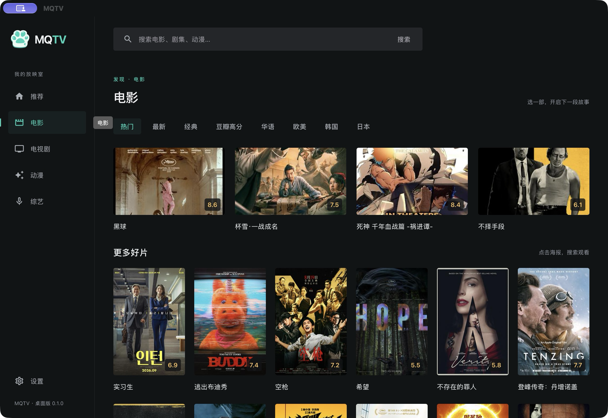

  

# 晴雨影视 · MQTV Desktop

每一个好故事，都值得被发现。

晴雨影视是一款桌面影视客户端，将影片发现、资源搜索、选集播放和夸克授权集中在同一个界面中。支持默认资源服务与自定义订阅，采用深色界面，适合在电脑上浏览和观看。

[界面预览](#界面预览) · [开始使用](#开始使用) · [兼容与配置](#兼容与配置) · [免责声明](#免责声明) · [致谢](#致谢) · [开发文档](docs/development.md)

## 界面预览

本机 macOS 打包版本（0.1.0）的电影频道实拍。截图中的内容随第三方服务变化，界面可能与后续版本有所不同。

## 应用功能

- **发现影片**：浏览推荐、电影、电视剧、动漫与综艺；动漫频道提供今日推荐、每日放送安排及日漫、国漫分类。
- **统一搜索**：按片名搜索已接入的来源，同名影片归并展示，详情中可切换来源与选集。
- **资源订阅**：使用默认服务，或添加多个自定义资源地址，分别启用、停用和检查。
- **桌面播放**：提供进度拖动、前后跳转、音量、倍速、上下集与全屏，环境支持时可使用画中画。
- **最近观看**：在本机保存播放记录与进度，便于继续观看。
- **夸克授权**：支持扫码登录及授权码领取，凭证保存在系统安全存储中。
- **版本检查**：在基础设置中手动检查适用于本机的版本，通过系统浏览器下载安装包后手动安装。

## 开始使用

1. 安装与本机系统、处理器架构匹配的晴雨影视安装包，启动应用。
2. 打开「设置 → 资源服务」，选择默认服务，或切换到自定义并添加有权使用的 HTTP(S) 资源订阅地址。自定义订阅解析成功后保存并启用。
3. 在顶部输入片名搜索，或点击推荐影片进入搜索；打开结果后选择来源和集数播放。
4. 使用夸克来源时，在「设置 → 授权管理」完成扫码或输入可用授权码。使用授权码需要相应后台提供服务。
5. 需要更新时，打开「设置 → 基础设置」，点击「版本更新」右侧图标检查。

推荐列表、封面和资源配置会在本机缓存。网络或来源异常时，按界面提示重试；订阅解析成功、出现影片条目和能够实际播放是不同阶段，最终以播放结果为准。

## 兼容与配置

### 系统与播放环境

| 项目 | 说明 |
| --- | --- |
| macOS | 使用系统 WebKit 播放环境，授权凭证保存到 Keychain；安装包需匹配本机架构 |
| Windows | 使用 WebView2 播放环境，授权凭证保存到 Credential Manager；安装包需匹配本机架构 |
| Linux | 当前授权与更新流程围绕 macOS / Windows 实现，尚未确认完整支持 |
| 浏览器 | 仅供界面预览；推荐、搜索、网盘授权与播放应使用桌面客户端 |
| 视频格式 | 支持 HLS 播放流程；实际音视频解码、全屏及画中画能力取决于系统 WebView 与片源 |

项目尚未给出经过完整验证的最低系统版本和全平台兼容清单，请以具体安装包的要求及实际运行结果为准。

### 资源订阅兼容

| 资源类型 | 当前支持情况 |
| --- | --- |
| 标准资源接口 / TVBox `sites` 配置 | 可解析订阅；可搜索数量取决于其中的来源类型 |
| HTTP CMS 来源 | 支持 `type: 1`、API 为 HTTP(S) 地址且非 `.js` 脚本的来源，需允许搜索 |
| WoGG 夸克来源 | 支持已适配的 WoGG 来源；站点配置使用有效的 HTTPS 地址 |
| Android JAR / JavaScript 插件 | 不运行这些插件；导入含插件的订阅不代表插件可用 |
| 其他网盘 | 当前网盘授权与播放适配集中在夸克，其他网盘需另行适配 |

默认和自定义订阅均允许已适配且允许搜索的 HTTP CMS 与 WoGG 来源共同参与搜索；未适配插件仍不执行，不自动启用后台停用线路。

自定义订阅可独立开关。新增或编辑时先获取并解析，失败则保留原配置；已保存订阅在校验失败后会显示错误并停用，可通过「检查全部资源」重试。

### 授权与本机数据

- 扫码授权与授权码领取是两种独立方式。扫码成功后使用本机扫码账号；扫码授权失效需重新扫码。
- 授权凭证存入系统安全存储，不写入浏览器 localStorage；扫码凭证不上传资源服务。
- 点击夸克选集播放后，应用会将视频转存到当前授权账号的 `MQTV` 目录并复用已有文件，**不会自动删除网盘文件**。请确认账号权限与可用空间。
- 自定义订阅、播放历史与缓存保存在本机。请勿在截图、问题反馈或公开订阅地址中包含授权码、Cookie 等凭证。

### 播放快捷键

播放器聚焦时可使用以下快捷键：

| 按键 | 操作 |
| --- | --- |
| 空格 | 播放 / 暂停 |
| ← / → | 后退 / 前进 10 秒 |
| M | 静音切换 |
| F | 全屏切换 |
| Esc | 退出窗口内铺满模式 |
| [ / ] | 上一集 / 下一集 |

上下集操作以当前来源和可用选集为准，首尾集不会越界，也不会自动连播。

## 免责声明

- 晴雨影视是资源聚合、搜索与播放客户端，不提供影片版权授权。资源服务、订阅和片源由相应提供方负责；推荐信息不代表本应用拥有或获准分发对应影片。
- 请仅接入、访问和播放你拥有合法使用权的内容，遵守所在地法律法规及相关服务条款，不得用于侵权传播或其他违法用途。
- 第三方来源的内容、可用性、更新速度和播放质量可能随时变化。动漫放送安排仅供参考，不保证播放来源已同步更新。
- 海报、片名、简介及相关商标等权利归各自权利人所有，界面展示用于内容识别。若涉及权益问题，请通过项目维护渠道提供具体信息以便核查处理。
- 使用网盘登录、转存和播放功能时，请确认账号归属与授权范围；转存可能占用网盘空间，相关限制以网盘服务规则为准。

## 致谢

感谢以下开源项目、工具与公开数据服务：

| 项目 / 服务 | 用途 |
| --- | --- |
| [Tauri](https://tauri.app/) / [Rust](https://www.rust-lang.org/) | 桌面应用框架与原生能力 |
| [React](https://react.dev/) / [TypeScript](https://www.typescriptlang.org/) / [Vite](https://vite.dev/) | 界面开发、类型检查与构建 |
| [MUI](https://mui.com/) / [Emotion](https://emotion.sh/) | 界面组件、图标与样式 |
| [hls.js](https://github.com/video-dev/hls.js) | HLS 媒体播放 |
| [qrcode-generator](https://github.com/kazuhikoarase/qrcode-generator) | 登录二维码生成 |
| [reqwest](https://github.com/seanmonstar/reqwest) / [Tokio](https://tokio.rs/) / [keyring](https://github.com/open-source-cooperative/keyring-rs) | 原生网络、异步运行与系统凭证存储 |
| [Vitest](https://vitest.dev/) | 前端自动化测试 |
| [豆瓣](https://movie.douban.com/) | 影片发现信息与动漫列表 |

以上名称与商标归各自所有者。开源依赖遵循各自许可证；致谢不代表相关项目或服务与晴雨影视存在官方合作或背书关系。

## 开发与维护

本地运行、目录约定、环境变量、测试、缓存规则、签名与发布说明已移至 [开发文档](docs/development.md)，其他资料见 [文档目录](docs/README.md)。
