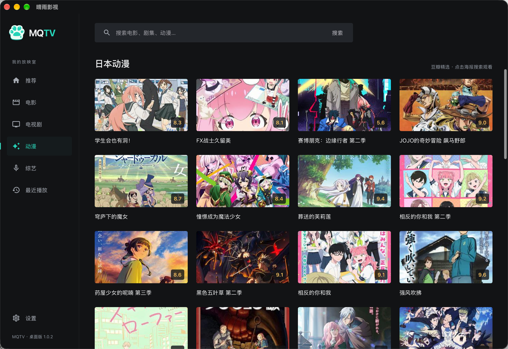
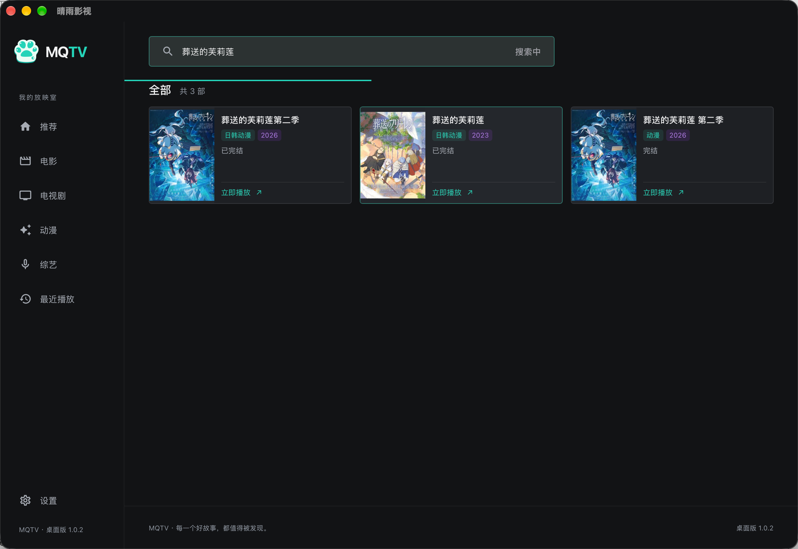
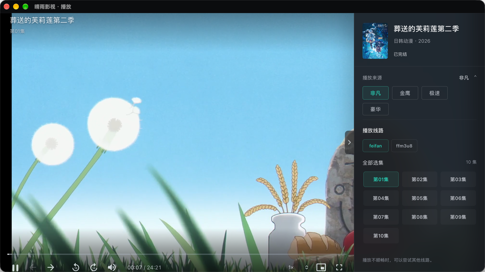
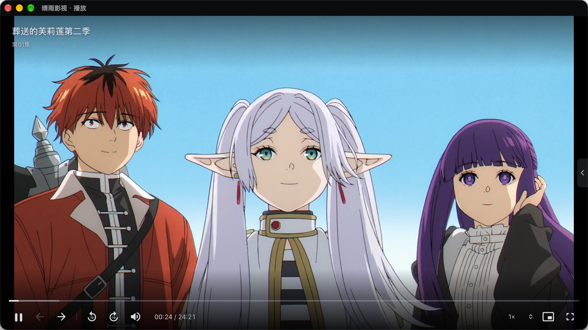
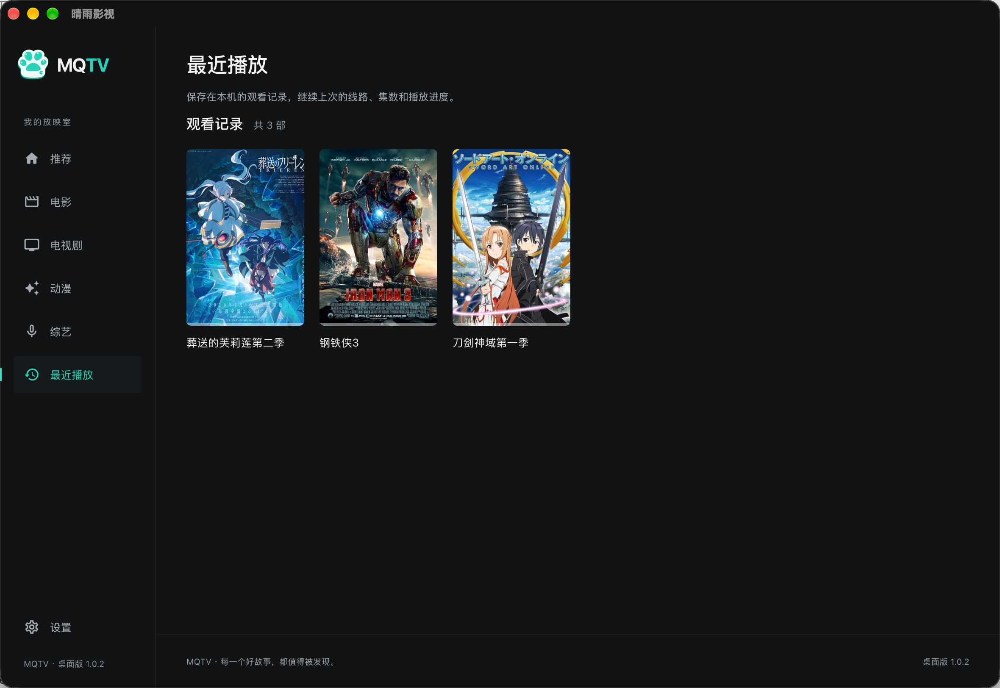
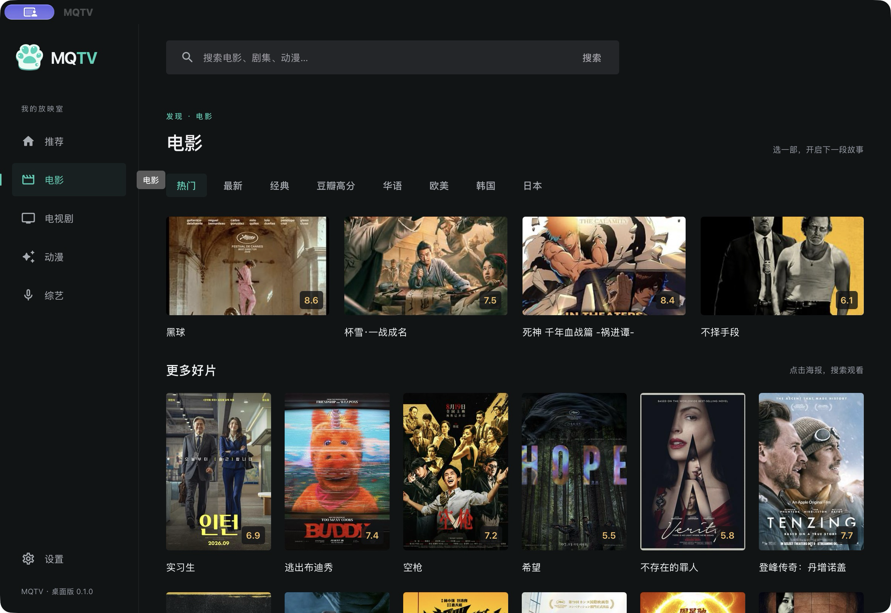

# 晴雨影视 · MQTV Desktop

每一个好故事，都值得被发现。

晴雨影视是一款桌面端第三方资源聚合播放器，提供影片发现、资源搜索、选集播放和观看记录。具体播放资源及订阅地址需由用户自行提供，并确保拥有相应的访问和使用权限。

[界面预览](#界面预览) · [开始使用](#开始使用) · [兼容与配置](#兼容与配置) · [免责声明](#免责声明) · [致谢](#致谢) · [开发文档](docs/development.md)

## 界面预览

以下截图展示 macOS 桌面端的影片发现、资源搜索、独立播放窗口和最近播放。界面与影片信息以实际使用时为准。

### 影片发现

按电影、电视剧、动漫和综艺浏览影片。动漫频道展示今日推荐及分类列表，点击海报可搜索相关资源。

### 资源搜索

输入片名后查看搜索结果，卡片展示海报、名称、分类、年份和更新信息，点击「立即播放」进入播放页。

### 独立播放窗口

在播放窗口右侧可切换来源、线路和集数。收起侧栏后可扩大播放区域。

### 最近播放

在主窗口打开「最近播放」，点击本机的观看记录，可继续上次的线路、集数和进度。

更多界面：电影频道

## 应用功能

- **发现影片**：浏览推荐、电影、电视剧、动漫与综艺；动漫频道提供今日推荐、每日放送安排及日漫、国漫分类。
- **统一搜索**：按片名搜索已接入的来源，同名影片归并展示，详情中可切换来源与选集。
- **资源订阅**：添加并管理用户自行提供的第三方资源订阅。
- **桌面播放**：提供进度拖动、前后跳转、音量、倍速、上下集与全屏，环境支持时可使用画中画。
- **最近观看**：在本机保存播放记录与进度，便于继续观看。
- **网盘授权**：K-K 与 U-C 支持个人扫码登录及邀请码授权，凭证分别加密保存在本地 SQLite 中。
- **版本检查**：在基础设置中手动检查适用于本机的版本，通过系统浏览器下载安装包后手动安装。

## 开始使用

1. 准备你有权使用的 HTTP(S) 资源订阅地址，在「设置 → 资源服务」选择「自定义」，添加订阅。订阅解析成功后保存并启用。
2. 在顶部搜索片名，或点击推荐影片进入搜索。打开结果后选择有权访问的来源和集数。
3. 使用自有网盘时，在「设置 → 授权管理」选择对应网盘扫码。U-C 使用 U-C 浏览器扫码。邀请码验证沿用现有的后台网盘授权流程。
4. 需要更新时，通过「设置 → 基础设置 → 版本更新」检查适用于本机的版本。

推荐列表、封面和资源配置会在本机缓存。网络或来源异常时，按界面提示重试；订阅解析成功、出现影片条目和能够实际播放是不同阶段，最终以播放结果为准。

## 兼容与配置

### 系统与播放环境

| 项目 | 说明 |
| --- | --- |
| macOS | 使用系统 WebKit 播放环境，授权凭证加密保存到应用本地 SQLite；安装包需匹配本机架构 |
| Windows | 使用 WebView2 播放环境，授权凭证加密保存到应用本地 SQLite；安装包需匹配本机架构 |
| Linux | 当前授权与更新流程围绕 macOS / Windows 实现，尚未确认完整支持 |
| 浏览器 | 仅供界面预览；推荐、搜索、网盘授权与播放应使用桌面客户端 |
| 视频格式 | 支持 HLS 播放流程；实际音视频解码、全屏及画中画能力取决于系统 WebView 与片源 |

项目尚未给出经过完整验证的最低系统版本和全平台兼容清单，请以具体安装包的要求及实际运行结果为准。

### 资源订阅兼容

| 资源类型 | 当前支持情况 |
| --- | --- |
| 标准资源接口 / TVBox `sites` 配置 | 可解析订阅；可搜索数量取决于其中的来源类型 |
| HTTP CMS 来源 | 支持 `type: 1`、API 为 HTTP(S) 地址且非 `.js` 脚本的来源，需允许搜索 |
| WoGG 网盘来源 | 支持已适配 WoGG 来源中的 K-K 与 U-C 分享；站点配置使用有效的 HTTPS 地址 |
| Android JAR / JavaScript 插件 | 不运行这些插件；导入含插件的订阅不代表插件可用 |
| 其他网盘 | 已适配 K-K 与 U-C，其他网盘需另行适配 |

已启用订阅中，适配且允许搜索的 HTTP CMS 与 WoGG 来源可共同参与搜索。

自定义订阅可独立开关。新增或编辑时先获取并解析，失败则保留原配置；已保存订阅在校验失败后会显示错误并停用，可通过「检查全部资源」重试。

### 授权与本机数据

- 扫码成功后使用本机扫码账号。
- K-K 与 U-C 授权凭证分别加密保存到应用本地 SQLite，不写入浏览器 localStorage，也不访问系统钥匙串；本机扫码凭证不上传资源服务。
- 点击 K-K 或 U-C 选集播放后，应用会将视频转存到当前授权账号的 `MQTV` 目录并复用已有文件，**不会自动删除网盘文件**。请确认账号权限与可用空间。
- 自定义订阅、播放历史与缓存保存在本机。请勿在截图、问题反馈或公开订阅地址中包含邀请码、Cookie 等凭证。

### 播放快捷键

播放器聚焦时可使用以下快捷键：

| 按键 | 操作 |
| --- | --- |
| 空格 | 播放 / 暂停 |
| ← / → | 后退 / 前进 10 秒 |
| M | 静音切换 |
| F | 全屏切换 |
| Esc | 退出窗口内铺满模式 |
| [ / ] | 上一集 / 下一集 |

上下集操作以当前来源和可用选集为准，首尾集不会越界，也不会自动连播。

## 免责声明

- 晴雨影视仅提供第三方资源聚合、搜索与播放功能。用户须自行提供具体播放资源或订阅地址，并确认来源与授权范围。邀请码仅用于客户端相关功能，影片及相关素材的使用和传播范围以权利人的授权为准。
- 请仅接入、访问和播放你有权使用的内容。共享订阅、转存文件或传播影片前，请确认已取得相应权限，并遵守适用法律及服务条款。
- 第三方来源的内容、可用性、更新速度和播放质量可能随时变化。动漫放送安排仅供参考，不保证播放来源已同步更新。
- README 截图用于展示软件界面和操作流程。其中的影片画面、海报、片名、简介及商标等素材所涉及的权利归各自权利人所有。
- 如发现 README 截图或应用展示内容涉及权益问题，权利人可通过项目维护渠道提交权利证明、相关截图或内容位置及联系方式，以便核查和处理。
- 使用网盘登录、转存和播放功能时，请确认账号归属与授权范围；转存可能占用网盘空间，相关限制以网盘服务规则为准。

## 致谢

社区: [认可 LINUX DO](https://linux.do/)

感谢以下开源项目、工具与公开数据服务：

| 项目 / 服务 | 用途 |
| --- | --- |
| [Tauri](https://tauri.app/) / [Rust](https://www.rust-lang.org/) | 桌面应用框架与原生能力 |
| [React](https://react.dev/) / [TypeScript](https://www.typescriptlang.org/) / [Vite](https://vite.dev/) | 界面开发、类型检查与构建 |
| [MUI](https://mui.com/) / [Emotion](https://emotion.sh/) | 界面组件、图标与样式 |
| [hls.js](https://github.com/video-dev/hls.js) | HLS 媒体播放 |
| [qrcode-generator](https://github.com/kazuhikoarase/qrcode-generator) | 登录二维码生成 |
| [reqwest](https://github.com/seanmonstar/reqwest) / [Tokio](https://tokio.rs/) / [keyring](https://github.com/open-source-cooperative/keyring-rs) | 原生网络、异步运行与系统凭证存储 |
| [Vitest](https://vitest.dev/) | 前端自动化测试 |
| [豆瓣](https://movie.douban.com/) | 影片发现信息与动漫列表 |

以上名称与商标归各自所有者。开源依赖遵循各自许可证；致谢不代表相关项目或服务与晴雨影视存在官方合作或背书关系。

## 开发与维护

本地运行、目录约定、环境变量、测试、缓存规则、签名与发布说明已移至 [开发文档](docs/development.md)，其他资料见 [文档目录](docs/README.md)。
